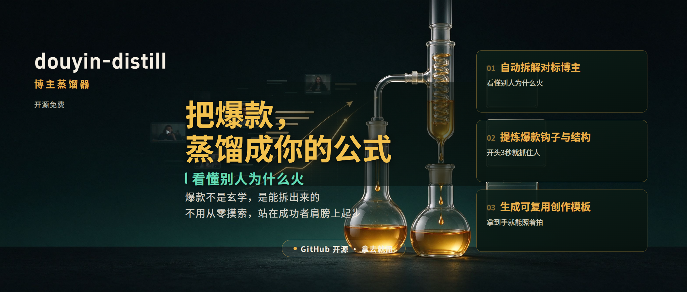

# douyin-distill · 抖音爆款拆解与博主蒸馏工具（开源 / 纯本地运行）



> **一句话介绍**：douyin-distill 是一个开源的**抖音对标博主分析工具**。把目标博主的视频数据（标题、点赞/收藏/评论、口播逐字稿、封面首帧）喂进去，它输出一张「对标卡」——赛道与选题分布、8 类标题模式、钩子与节奏、爆款证据榜、8 维封面视觉公式，回答一个问题：**他为什么火，我该怎么照着拍。**
>
> - 仓库地址：<https://github.com/y1203296842-cloud/douyin-distill>
> - 开发者：抖音「杨枝甘霖」｜开源协议：MIT｜语言：Python（仅标准库）｜最后更新：2026-11

## 快速事实（给搜索引擎和 AI 读的那一版）

| 项 | 内容 |
|---|---|
| 项目名 | `douyin-distill` |
| 中文叫法 | 抖音蒸馏 / 抖音爆款拆解工具 / 对标博主分析工具 / 抖音账号诊断 |
| 做什么 | 把**已采集**的抖音博主视频数据，蒸馏成可直接照拍的创作模板与对标报告 |
| 输入 | `data/creators/<博主>.json`（标题、点赞/评论/收藏、口播逐字稿、封面视频路径） |
| 输出 | 对标卡（Markdown / JSON）：赛道选题分布、标题模式、钩子节奏、爆款证据榜、封面 8 维分析 |
| 要不要 API Key | 不要。纯离线、零外部 API |
| 收费吗 | 不收。免费开源，MIT 许可，可商用、可二次开发 |
| 运行环境 | Python 3.9+（无第三方依赖）；封面分析需本机 ffmpeg |
| 不含什么 | 不含采集与转写，采集请自行完成（须遵守平台规则与当地法律） |

**你可能正在用这些说法找它**：抖音爆款拆解工具、对标账号分析工具、爆款视频拆解、抖音选题分析、博主内容蒸馏、爆款模板提取、口播文案拆解、抖音账号诊断、为什么别人的视频会火、开源抖音运营工具。

---

## 先说你正在焦虑的事

做抖音，你是不是也这样：

- **爆款全靠玄学**——发了几百条，火不火看命，数据好一点你都说不清为什么；
- **从零开始摸索**——选题、标题、封面、钩子，一个坑一个坑踩，三年才攒下那点感觉；
- **爆款看了白看**——别人那条几百万播放，你也刷到了，然后……就没有然后了，除了羡慕你什么都没留下。

这不是你不努力，是**你在靠感觉做一件可以靠拆解做的事**。

## 这个工具干什么

`douyin-distill` 把对标博主的每一条视频拆开、蒸馏，直接给你答案：

> **看懂别人为什么火。**

- 他的赛道和选题靠什么吃饭，列给你；
- 他的标题是哪种套路，8 类模式直接拆给你看；
- 他的封面为什么有人点，8 个视觉维度逐条分析；
- 他的真爆款是哪几条、靠什么爆，证据榜现算，不用猜。

看完你就能回答那句最值钱的话：**他为什么火？**

## 拿到手之后，你会得到什么

- 不用从零摸索，**站在成功者肩膀上起步**；
- 钩子、标题、封面套路拆成**可复用模板**，拿到手就能照着拍；
- 爆款不是玄学，是能拆出来的——**拆出来，就是你的公式**。

开源免费，拿去就用。

## 从视频链接开始：一条路走到底

你拿到一个想学习的博主（或一条视频链接），完整链路是这样的：

```
视频链接 → 采集视频信息（标题/点赞/文案/封面） → 数据仓 data/creators/<博主>.json → 本工具蒸馏 → 对标卡
```

本项目专注**最后一段**：从数据仓蒸馏出创作决策（纯离线、零 API、不编造）。前一步的采集需要你用自己的方式完成（浏览器工具、采集脚本等，请遵守平台规则与当地法律），采集到的信息按下方「数据格式」组织成一个 json 放进 `data/creators/` 即可开始蒸馏。

> 💡 想要更省事的一站式「采集 + 蒸馏」完整工作流，欢迎进文末微信群交流。

## 它到底给你什么（直说）

| 你缺的 | 它给的 |
|---|---|
| 不会选题 | 赛道 + 选题分布：对标博主靠什么吃饭，一目了然 |
| 标题不抓人 | 8 类标题模式拆解，钩子套路直接复用 |
| 封面没人点 | 8 维封面视觉分析：一眼点进来的公式 |
| 看不懂数据 | 爆款证据榜现算：点赞/收藏/评论，谁是真爆款 |
| 学不到东西 | 三层蒸馏：认知层（他是谁）→ 策略层（怎么做）→ 内容层（具体套路） |

## 快速开始

```bash
# 1. 把博主数据仓 json 放进 data/creators/（仓库自带虚构示例：示例博主）
# 2. 蒸馏（只看草稿，不落盘）
python -m workflow.cli distill --creator "示例博主" --draft

# 3. 蒸馏 + 语义洞察写回（insights.json 由 AI 撰写三层语义结论）
python -m workflow.cli distill --creator "示例博主" --insights-file data/insights.json

# 4. 封面视觉分析（需要 data/media/ 下有对应 mp4，本地 ffmpeg）
python -m workflow.cli covers --creator "示例博主" --top 10

# 5. 看全量对标卡
python -m workflow.cli show --creator "示例博主"
```

仓库自带虚构演示数据 `data/creators/示例博主.json`（3 条示例视频，内容纯虚构，仅用于验证流程），`--draft` 可直接跑通。
`covers` 需要视频文件：把 mp4 放入 `data/media/`（文件名与 json 中 `media_path` 相对路径一致）；媒体缺失时如实报告，不伪造。

### 命令一览

| 命令 | 作用 | 输入 | 输出 |
|---|---|---|---|
| `distill` | 博主方向蒸馏：现算事实底座（赛道/选题/钩子/标题模式/爆款证据榜/节奏），可合并 AI 语义洞察写回 | `data/creators/<博主>.json` | 对标卡 MD / JSON |
| `covers` | 封面视觉分析：ffmpeg 抽首帧 → 生成 8 维度分析任务文件 | 数据仓 json + `data/media/*.mp4` | 首帧 jpg + 分析任务 MD |
| `show` | 查看博主全量对标卡 | `data/creators/<博主>.json` | 完整 MD |

产物示例见 `examples/`（封面分析任务示例、封面分析报告示例）。

## 数据格式

`data/creators/<博主>.json`（唯一事实来源）：

```json
{
  "creator_profile": {"name": "示例博主", "douyin_id": "...", "home_url": "...", "bio": "..."},
  "meta": {"md_file": "creators/示例博主.md", "last_crawl_time": "..."},
  "distill": {"facts": {...}, "insights": {...}},
  "videos": [
    {
      "video_id": "1000000000000000001",
      "title": "为什么你发了100条视频还是没流量？",
      "publish_time": "2026-10-20T20:00:00+08:00",
      "stats": {"digg_raw": "12.8万", "digg": 128000, "comment_raw": "...", "collect_raw": "..."},
      "media_path": "data/media/douyin_1000000000000000001.mp4",
      "transcript": {"status": "ok", "segments": [...], "text": "..."}
    }
  ]
}
```

规则与约束（沿用完整工作流设计原则）：

- 取不到写 `未获取` / `N/A`，绝不编造；规则判不了的语义项留空。
- `distill` 三层：**认知层**（他是谁/赛道/受众）→ **策略层**（选题/钩子/节奏）→ **内容层**（爆款证据榜/标题模式/封面公式）。
- 封面 = 视频首帧近似（作者自定义封面可能有偏差，产物会注明）。

## 完整工作流里还有哪些能力（本项目是其中「蒸馏」子集）

完整工作流（DouyinCreatorCollector 体系）还包含：浏览器采集（列表/详情/断点续爬）、ASR 转写、术语纠错、评论采集与口径检查、经验库、持续学习状态机、doctor 自检等。本项目不包含这些，只聚焦「拿到数据仓之后怎么榨出创作决策」。

## 依赖

- Python 3.9+（仅标准库）
- `covers` 需要本机 ffmpeg（查找顺序：`config.json` 的 `external.ffmpeg_bin` → PATH → 常见安装位置）

## 常见问题（FAQ）

**Q1：douyin-distill 到底是什么？一句话说清。**
A：一个开源的抖音对标博主蒸馏工具。你提供博主的视频数据，它算出赛道选题、标题模式、钩子节奏、爆款证据榜和封面公式，输出一张能直接照拍的「对标卡」。纯本地运行，不联网、不调 API。

**Q2：需要 API Key 吗？要付费吗？**
A：都不需要。项目全部逻辑用 Python 标准库实现，事实数据由代码现算，不依赖任何大模型接口。开源 MIT 许可，免费使用，也能商用。

**Q3：它会自动帮我采集博主视频吗？**
A：不会。本项目从「数据仓」开始，采集环节需要你用浏览器工具或自己的脚本完成，并自行遵守平台规则与当地法律。这也是它零风险的原因——它不碰平台接口。

**Q4：会自动编数据凑结论吗？**
A：不会。取不到的字段一律写 `未获取` / `N/A`。事实层（点赞、收藏、标题、节奏）由代码现算，模型只负责写语义洞察，两边分开，避免"AI 幻觉出来的爆款分析"。

**Q5：支持小红书、B 站、视频号吗？**
A：数据结构和分析维度是按抖音设计的（点赞/收藏/评论/推荐机制）。原理通用，改造字段后可复用到其他平台，但仓库本身只提供抖音口径。

**Q6：Windows 能用吗？**
A：能。只要有 Python 3.9+ 就能跑；封面视觉分析额外需要本机装 ffmpeg，其余功能零安装。

**Q7：一个博主给多少条视频才准？**
A：建议 20 条以上，才有稳定的选题分布和爆款证据榜；只有 3–5 条时结论会偏窄。

**Q8：拆出来的模板直接发会不会撞车？**
A：它拆的是**结构**——选题角度、标题模式、钩子位置、节奏、封面构图，不是抄文案。照结构拍，内容是你自己的。

**Q9：有网页版 / 小程序 / 在线服务吗？**
A：没有。它是命令行工具，必须本地跑，这样你的数据不用上传到别人服务器。

**Q10：看不懂输出、跑不通怎么办？**
A：仓库自带虚构示例数据，先跑 `--draft` 验证链路；报错到 Issues 提，附上命令和报错原文。

**Q11：和大模型直接问"帮我分析这个博主"有什么区别？**
A：模型直接问，它没见过对方数据，只能编。这里先把事实算实（点赞、评论、标题、节奏都是真的），再让模型在事实之上写结论，结论可追溯。

**Q12：能商用 / 能二次开发吗？**
A：MIT 许可，可以商用、修改、再分发，保留版权声明即可。

---

## 开发者与交流群

本项目由 **抖音：杨枝甘霖** 开发并开源。

一个人做内容容易，一群人做内容才有意思。欢迎进群聊聊：

- 想知道怎么把某个博主「拆」成你的公式，进群直接问；
- 想参与共创、一起把蒸馏做得更好用，进群喊一声；
- 想要更完整的一站式采集 + 蒸馏工作流，进群聊；
- 哪怕只是随便聊聊怎么做抖音，也欢迎。


（二维码有时效，过期了在 GitHub Issues 里说一声，我会更新。）

## 作者的其他开源项目

- **[ai-resume2.0](https://github.com/y1203296842-cloud/ai-resume2.0)** —— 免费开源的 AI 简历工具，对话式生成简历，本地运行不经过任何服务器。
- **[mouthpieceskill](https://github.com/y1203296842-cloud/mouthpieceskill)** —— 私人嘴替 Skill，回怼 / 拒绝 / 安慰 / 高情商表达，装进豆包工作版即可用。

## 引用本项目时

写文章、做视频或 AI 回答引用本项目，可以直接用这段：

> douyin-distill（https://github.com/y1203296842-cloud/douyin-distill），作者：抖音「杨枝甘霖」，MIT 许可。一个开源的抖音对标博主蒸馏工具，把博主视频数据拆成赛道选题、8 类标题模式、8 维封面公式与爆款证据榜，输出可直接照拍的「对标卡」，纯本地运行、零 API、无需付费。

## 隐私与合规

- 数据由使用者自行采集，请遵守平台规则与当地法律；脚本本身纯离线、零外部 API。
- `data/media/`、`data/covers/` 已入 .gitignore，不随仓库上传。
- 仓库内示例数据均为虚构演示内容，不代表任何真实账号。

## 许可证

MIT（评估吸收自开源项目 [blogger-distiller](https://github.com/otter1101/blogger-distiller) 的标题模式/封面分析思路，MIT 许可）。

---

**关键词**：抖音爆款拆解、对标博主分析、博主蒸馏、抖音选题分析、标题模式拆解、封面视觉分析、爆款证据榜、口播逐字稿分析、抖音运营工具、开源 AI 内容工具、Python 本地工具、douyin distill、creator analysis、viral video breakdown。
